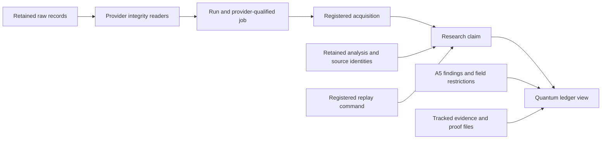

# Quantum evidence ledger

The quantum research registry already owns claims and acquisitions. The A5
exceptional-fiber ledger owns finer algebraic findings, including deciding
evidence and falsifiers. A quantum reconciliation needs the full scientific
qualifications beside the retained observations, plus a denominator that exposes
records outside the registered claims. `scripts/results_index.py ledger`
composes those authorities; `gororoba_quantum/quantum_ledger.py` implements the
reusable projection and exact JSON-field navigation.

## Authority and relations

The arrows name declared relations and validation mechanisms. They do not
certify causal effects. The ledger retains four distinct judgments:

| Judgment | Authority | Limit |
| --- | --- | --- |
| Claim status | `docs/state/research_state.json` | A status belongs to its evidence class and stated boundary |
| Retained binding | `research_state.validate` and provider readers | Digest, receipt and supported record consistency checks establish integrity |
| Numerical reproduction | The claim's registered replay command and an observed execution result | Listing a command establishes an available procedure; the ledger executes none |
| Physical inference | The frozen case, estimator, dependence model and controls | Successful parsing or numerical reproduction does not establish the model's physical assumptions |

An acquisition has a stable registry ID and a run path. A job uses the pair
`(provider, job_id)`; the same text from two providers describes two identities.
A claim can cite several acquisitions, and an acquisition can support several
claims. The ledger never sums those joins into a shot count or experiment count.

An artifact has a repository-relative path. Direct claim bindings retain the
whole-file digest or the existing selected-record digest. Containment in a run
directory is a separate relation. Source descriptions carry a whole-file digest
even when a claim binds only one selected record; the two hashes have different
objects and remain separate. Historical producer hashes stay observations of
the historical source, while current file hashes identify the queried bytes.

The A5 rows retain their field scopes, status vocabulary, basis and falsifier.
The combined view invokes the A5 ledger's own header and row validator before
publishing those rows. Schema, evidence-path and supersession checks retain
their integrity scope; they establish no new mathematical result.
An exact finite-field rank, a characteristic-zero theorem, an ideal circuit
check, a noisy simulation and a physical observation keep separate meanings.
An evidence-path overlap supplies a navigation link, never an algebra-to-device
implication. A physical claim needs an explicit registry dependency and its own
admitted measurement interpretation.

## Granular observations and numerical libraries

`observation FILE --pointer /path` selects the retained JSON value without
rewriting its meaning. A pointer can name a whole condition, count table,
denominator, uncertainty object, calibration record or source-hash map. Array
order, integer precision, null and zero survive. JSON objects with duplicate
member names are rejected before pointer selection,
including nested objects and names whose escape sequences decode identically.
Provider and analysis schemas remain source-native; the ledger does not guess that every field named
`shots` is an estimator's denominator.

| Scientific operation | Existing mechanism | Ledger responsibility |
| --- | --- | --- |
| Raw shot and histogram consistency | `qi_records.py`, `qd_platform.run_facts`, `iqm_jobs.run_facts`, IBM retention adapters | Preserve acquisition and job identity and expose the containing artifacts |
| Counts, covariance and ordered-shot diagnostics | NumPy and the existing family analyzers | Expose the retained condition and its source identity; replay through the family's command |
| Confidence intervals and likelihoods | SciPy with each analyzer's declared sampling model | Preserve the model, selection rule and denominator from the analysis; avoid pooling incompatible rows |
| Exact finite computations | `python-flint`, SymPy, Sage or Singular through their retained producers | Keep coefficient field, precision and witness scope with the mathematical claim |
| Circuit conformance | Qiskit/Aer, Perceval and the provider-specific compiler readers | Keep ideal semantics separate from device performance |
| Machine-checked proof | Rocq source and kernel receipt | Preserve the source/receipt binding; fresh compilation is a separate check |
| Discovery joins | Python dictionaries, JSON, CSV and disposable SQLite | Derive views from authority at query time |

The installed and retained library inventory lives in
[the Python guide](../PYTHON.md). The ledger reads recorded version fields and
provenance blocks; a new storage engine or numerical dependency supplies no
scientific qualification by itself. JSON and CSV remain the durable source
formats. SQLite remains a disposable query cache. Parquet becomes a justified
export when a measured cross-run query needs it; a publication bundle can export
provenance from the same relations without becoming another claim authority.

## Coverage and reconciliation rules

The census includes all tracked artifacts in the three named roots and all
registered claim evidence/documents elsewhere. Ignored session scratch, other
worktrees, remote provider state and private document repositories remain outside
that denominator. A tracked file is an artifact, not automatically an experiment.
The four provider adapters define registered acquisition coverage. Quandela
discovery includes submitted case directories as well as `runs/`; the same
offline reader checks both locations. An unsubmitted case remains a plan.
IBM audit records classify unexecuted cancellations separately from acquisitions.
Kaggle
receipts define compute-session coverage. Other execution records remain visible
as candidates outside the indexed runs until an appropriate reader classifies
their actual schema and execution state.

The detailed gap lists answer separate questions:

- An unclaimed acquisition needs a bounded interpretation or an explicit
  decision to retain it as uninterpreted evidence.
- A claim without a replay gate needs examination of its proof or analysis
  procedure. A proposed experiment or source theorem may legitimately lack one.
- A claim without pinned evidence can still have a proof document or a
  deterministic replay; the gap does not refute the claim.
- An unlinked artifact needs classification against its schema and producer.
  Case definitions and proposals commonly belong to this set.
- An execution record outside indexed runs needs dispatch and terminal-state
  inspection. A planned record supplies no completed measurement.

A numerical disagreement stays tied to the raw file, analysis version and
estimator. Its repair changes the appropriate derived record and binding, or
introduces a versioned successor where an approval or replay pins the producer.
Raw provider bytes retain their identity. A new provider action follows the
repository's separate written-case and authorization rules.

The registry's boundaries contain scientific limitations in prose. The registry
does not yet supply a uniform endpoint schema for numerator, denominator,
uncertainty method, calibration/dependence group and falsifier. The pointer view
exposes those values where the retained analysis supplies them; it cannot infer
missing semantics. A family-specific typed adapter earns admission with raw
fixtures, a named estimator contract and a replay comparison against the
existing analyzer. The evidence table in `pathion_evidence_table.py` exemplifies
that approach. A universal numerical adapter based on field-name heuristics
would misclassify postselection, shared shots and conditional acceptance.

## Verification and operation

[The results-index runbook](../runbooks/results-index.md#quantum-evidence-ledger)
gives the ledger and observation commands. Synthetic tests mutate evidence
bytes, claim statuses and dependency edges, exercise provider collisions and
JSON Pointer failures, and verify that a registered gate never becomes a passed
replay. Retained-tree checks run on demand. The
[reconciliation record](../evidence/quantum-ledger-reconciliation/README.md)
records the measured census, the exercised raw replay and the remaining gaps.
