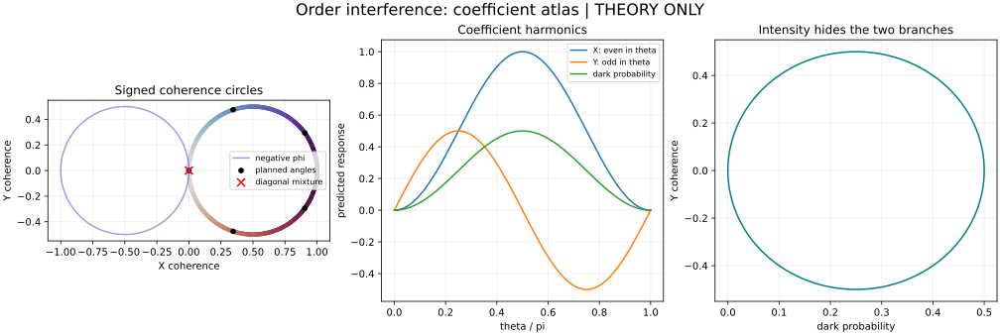

# Ascella order-coherence coefficient derivation

The [science plan](../../design/ascella-signed-coherence-conformance.md) asks
whether hardware preserves commutator/anticommutator interference. This bundle
supplies local mathematical evidence and a theoretical artwork preview.
It contains no new hardware acquisition.

[replay.py](replay.py) checks nine exact identities with SymPy (the coherence
circle and its intensity links, the complex form `C=(1-exp(-2i theta))/2`, the
complex-gain coefficients, cancellation of a common phase, and the rotated
coefficient relations), compares source-state and coherence formulas with the
repository operator at 51 points, and extracts all five discrete harmonic
coefficients at each of five planned angles. It also computes the
27-endpoint Hoeffding radii (sign-odd and sign-even X/Y, dark and mutation),
their scale against the superseded 17-endpoint family, the reconstructed
sign-specific radii, the
pointwise envelope of the 0.05 coefficient tolerance, the projected
simultaneous X/Y radius at each planned angle, and the equal-contrast and
sign-even counterexamples, checking the latter for positivity and for
rejection by the sign-even endpoints at expected counts, and a weak 0.05 twist
whose intervals exclude the exact ideal yet stay inside the coefficient tolerance. [derivation.json](derivation.json) records residuals,
source and pilot-analysis digests, tool versions and the pilot's dark counts.
The pilot counts come from the retained analysis; the curve is theoretical.



The four panels show the sign-odd coherence circle with angle labels,
traversal direction and projected simultaneous radii; the sign-even response,
a primary endpoint with ideal value zero, with the replay's counterexample; the angle
harmonics; and the two coherence branches that direct intensity cannot
distinguish. The black
points mark planned angles; they are not measurements. The final measured
artwork uses new retained counts and simultaneous uncertainty.

Run from the repository root with the intended interpreter:

```sh
export PYTHON="${PYTHON:-python3}"
export GLIBC_TUNABLES=glibc.rtld.optional_static_tls=4096
"$PYTHON" docs/evidence/ascella-order-coefficients/replay.py
```

The default invocation recomputes and prints its checks without writing files. `--check` recomputes and requires the retained `derivation.json` to match, floats within 1e-12 and tool versions aside; gate sources-394 runs it.
The `--write` option generates the report and SVG in the script directory;
use a separate successor location for any later retained revision. Numerical
residuals use an absolute 1e-12 bound. Exact identities must reduce to zero.
The checks establish these finite formulas; they do not verify a future native
payload, a physical analyzer or a continuous experimental response.

[`case-preflight/`](case-preflight/preflight.json) retains the read-only
plan of the written acquisition case in
[the design](../../design/ascella-signed-coherence-conformance.md#written-acquisition-case),
as `scripts/ascella_coherence_request.py --preflight` wrote it. `preflight.json`
holds the platform row and processor figures, token occupancy, the credit
ceiling, Perceval's shot estimate and the planned body's digest without
`process_id`. `catalogue.json` is `qd_platform.snapshot`'s catalogue, and
`observation.json` holds `qd_platform.observe`'s raw answers of every
readable provider route. None of these files grants approval.

The device readings of the two acquisitions come from
[`scripts/ascella_coherence_repeat.py`](../../../scripts/ascella_coherence_repeat.py).
[`job-00-diagnostics.json`](job-00-diagnostics.json) and
[`job-01-diagnostics.json`](job-01-diagnostics.json) hold each run's
exploratory reading (`--diagnose`): outside-block counts and their mode
composition against the plan-time dark rates, their serial structure, the
compiled-circuit check, the analyzer contrast fits with per-setting residuals,
and the endpoints under block-conditioned denominators. Two fields of those
records carry no inferential reading: `residual_chi2` standardizes
ordinary-least-squares residuals by unequal variances and has no chi-square
reference, and the `block_less_dark_share` variant passes estimated,
clipped, fractional counts to the Hoeffding engine, so its `verdicts` and
`ideal_excluded` are descriptive sensitivity values without the registered
coverage.
[`repeat-comparison.json`](repeat-comparison.json) holds the preregistered
comparison of the permuted repeat with job-00 (`--compare`).
[`response-geometry.json`](response-geometry.json), from
[`scripts/ascella_response_geometry.py`](../../../scripts/ascella_response_geometry.py),
holds the exploratory reading of both runs with analytic references: the
gain relations projected onto the simultaneous intervals, inverse-variance
contrast fits, dilution fractions, outside-block profile tests, the
two-component background fit, the configuration grouping and the held-out
prediction of job-01.
[`physical-models.json`](physical-models.json), from
[`scripts/ascella_physical_models.py`](../../../scripts/ascella_physical_models.py),
holds the preregistered physical-model test: shared error families of the
returned 12-mode meshes fitted on job-00 and scored on job-01's pooled
configurations, with supplementary families and a leave-one-configuration-out
refit of the static ones
([design](../../design/ascella-signed-coherence-conformance.md#restricted-physical-models-of-the-analyzer-response)).
[`configuration-holdout.json`](configuration-holdout.json), from
[`scripts/ascella_configuration_holdout.py`](../../../scripts/ascella_configuration_holdout.py),
holds the leave-one-configuration-out refit of the static families from the
training configurations alone, scored in counting plus fitted-prediction
variance; it supersedes the left-out column of `physical-models.json`
([design](../../design/ascella-signed-coherence-conformance.md#leave-one-configuration-out-from-training-data)).
[`heater-drive-holdout.json`](heater-drive-holdout.json), from the same
script with `--drive`, holds the preregistered drive-dependent heater family
(heater offsets and per-heater drive slopes) under those folds
([design](../../design/ascella-signed-coherence-conformance.md#drive-dependent-heater-response-under-the-same-folds)).
The `core-ascella-signed-coherence-*` gates replay the first four within the
certificate tolerance, and the last three replay their nominal family there and
their fitted families within 1e-3 relative plus 1e-8 absolute, the rounding of
optimizer endpoints under another BLAS build.
